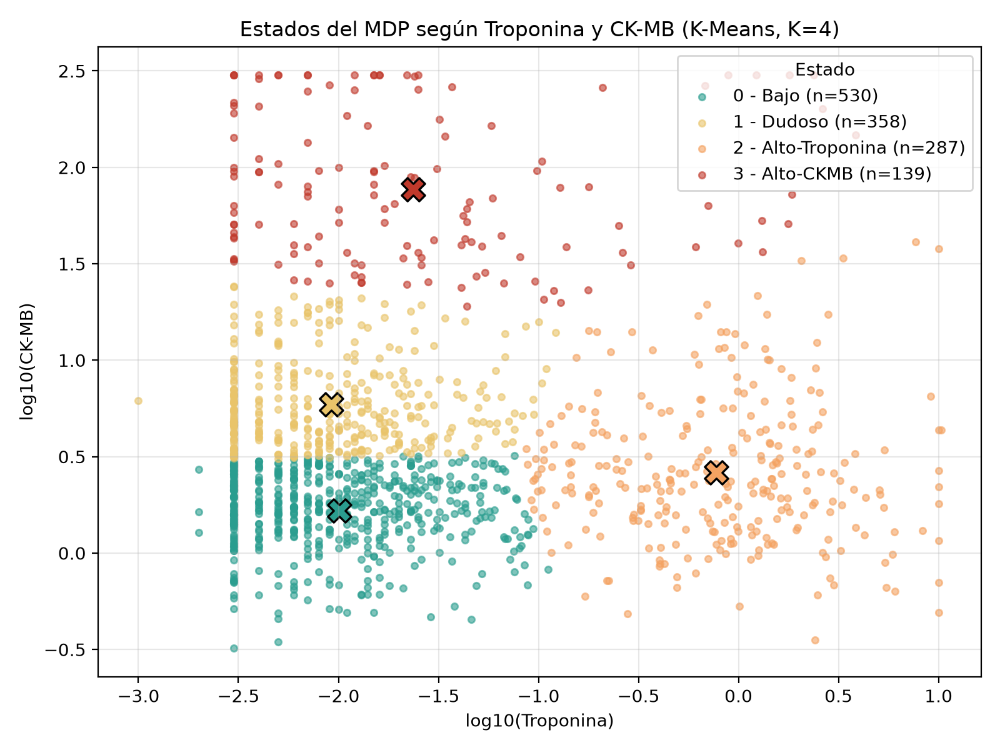
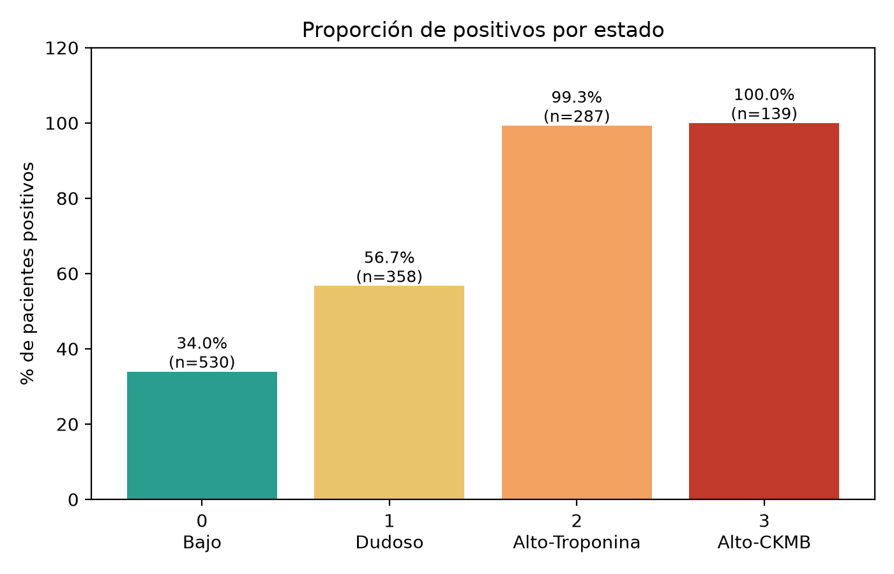

# MDP — Detección temprana de pacientes con posible infarto

Taller 1, Corte 3 (Aprendizaje por Refuerzo). Proyecto que modela un **Proceso de
Decisión de Markov (MDP)** sobre un conjunto de datos médicos para decidir el nivel
de atención (triaje) de cada paciente según sus marcadores cardíacos, minimizando el
error más costoso: no detectar un infarto.

> Los grupos y supuestos son descriptivos, no diagnósticos, y no sustituyen la
> evaluación de un profesional de la salud.

## El MDP en una línea

- **Estados** `S = {Bajo, Dudoso, Alto-T, Alto-CK}` — perfiles de riesgo (K-Means sobre troponina y CK-MB).
- **Acciones** `A = {ESCALAR, REPETIR, SEGUIMIENTO}` — semáforo rojo / amarillo / verde.
- **Recompensa** `R(s,a)` — basada en el costo de cada error (el falso negativo cuesta −1000).
- **Transición** `P(s'|s,a)` — construida consultando los modelos (AdaBoost + K-Means).
- **Solución** — Iteración de Valor (γ = 0.9) → la política óptima es **ESCALAR en los 4 estados**.

## Requisitos

- Python 3
- `numpy`, `pandas`, `scikit-learn`, `joblib` y `matplotlib`

```bash
python3 -m venv .venv
source .venv/bin/activate            # Windows: .venv\Scripts\activate
python -m pip install numpy pandas scikit-learn joblib matplotlib
```

## Cómo ejecutar (en orden)

Cada script usa las salidas del anterior. Con `Medicaldataset.csv` en la carpeta:

```bash
python estados.py          # Parte 2, Pasos 1-2: limpieza + estados (K-Means)
python recompensa.py       # Parte 2, Paso 3a: R(s,a)
python transiciones.py     # Parte 2, Paso 3b: P(s'|s,a)
python politica_mdp.py     # Parte 2, Pasos 4-5: Iteración de Valor + política
python grafica_politica.py # Parte 3: distribución de la política + "batalla"
python grafica.py          # (opcional) gráficas de los estados (Parte 2)
```

## Qué hace cada paso

### Pasos 1-2 — Estados (`estados.py`)
Limpia el dataset (elimina 5 filas con frecuencia cardíaca imposible → 1314 filas),
transforma troponina y CK-MB con `log10`, los estandariza y agrupa con **K-Means (K=4)**.
Reordena los grupos por proporción de positivos y los nombra Bajo, Dudoso, Alto-Troponina
y Alto-CKMB. Guarda `dataset_con_estados.csv`, `perfil_estados.csv` y `modelo_estados.joblib`.

### Paso 3a — Recompensa (`recompensa.py`)
Define la recompensa base por decisión según el resultado real del paciente
(ESCALAR +100/−10, REPETIR −40/−3, SEGUIMIENTO **−1000**/+5) y promedia por estado para
obtener `R(s,a)`. El falso negativo (dejar en SEGUIMIENTO a quien sí tiene infarto) se
penaliza ~100× una falsa alarma. Salida: `recompensa.csv`.

### Paso 3b — Transiciones (`transiciones.py`)
**Opción B** (se descartó `shift(-1)` porque cada fila es un paciente, no una serie de
tiempo). Entrena **AdaBoost** para estimar `p = P(infarto | paciente)`, simula cómo
cambian troponina y CK-MB en el siguiente control según la acción (multiplicadores
×0.40 ESCALAR, ×1.15 REPETIR, ×1.60 SEGUIMIENTO sobre pacientes con infarto; sanos ×1.00
con 10 % de ruido), reasigna el estado con `K-Means.predict()` y normaliza cada fila a 1.
Salidas: `transiciones.npz` y `P_ESCALAR.csv`, `P_REPETIR.csv`, `P_SEGUIMIENTO.csv`.

### Pasos 4-5 — Política (`politica_mdp.py`)
Resuelve el MDP con **Iteración de Valor** (`V(s) ← maxₐ[R(s,a) + γ·Σ P(s'|s,a)·V(s')]`,
γ = 0.9) hasta converger, y extrae la política óptima `π*(s) = argmaxₐ Q(s,a)`.
Resultado: **ESCALAR en los 4 estados**. Salidas: `politica_optima.csv`, `valores_estado.csv`.

### Parte 3 — Batalla de políticas (`grafica_politica.py`)
Grafica la distribución de la política óptima y la compara contra estrategias simples
evaluando `V^π = (I − γP_π)⁻¹ R_π`. La política del agente (**+428** aprox.) es la única
con valor positivo y supera a "nunca actuar" (SEGUIMIENTO, ≈ −8 400) por casi 9 000 puntos.
Salidas: `grafica_distribucion_politica.png`, `grafica_batalla_politicas.png`, `batalla_politicas.csv`.

> **Nota de reproducibilidad.** `transiciones.py` genera `P` por simulación (semilla fija),
> por lo que sus valores pueden variar ±0.01 y los `V*` en unos pocos puntos frente a los de
> la presentación. La **política óptima y las conclusiones son idénticas**.

## Archivos principales

| Archivo | Rol |
|---|---|
| `estados.py` | Pasos 1-2: limpieza, estados (K-Means) |
| `recompensa.py` | Paso 3a: `R(s,a)` |
| `transiciones.py` | Paso 3b: `P(s'|s,a)` (AdaBoost + K-Means) |
| `politica_mdp.py` | Pasos 4-5: Iteración de Valor + política |
| `grafica_politica.py` | Parte 3: distribución + batalla de políticas |
| `grafica.py` | Gráficas de los estados |
| `Medicaldataset.csv` | Dataset de entrada |

## Gráficas de los estados




